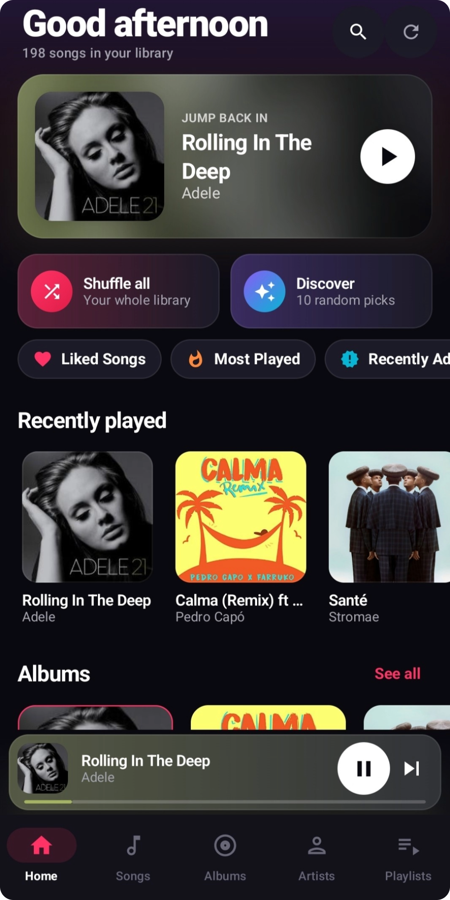
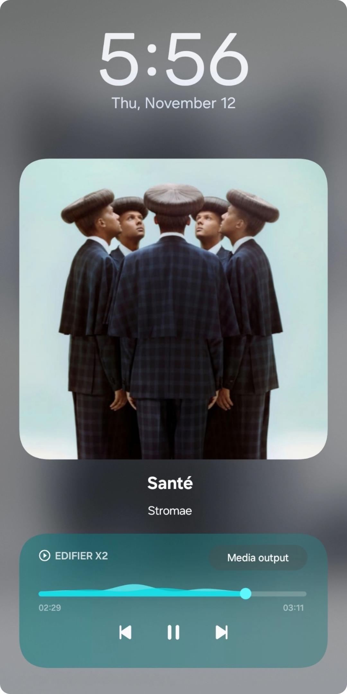

# Muzik

[](https://github.com/lordyhas/muzik/actions/workflows/ci.yml)
[](https://github.com/lordyhas/muzik/releases/latest)
[](https://developer.android.com/about/versions/nougat)
[](LICENSE)

**Muzik** is a modern, lightweight local audio player for Android built with Google's recommended stack: **Jetpack Compose**, **Material 3**, and **AndroidX Media3 (ExoPlayer)**.

It provides a seamless, fast, and elegant offline listening experience with zero ads and no internet connection required.

<p align="center">
  
  &nbsp;
  
  &nbsp;
  
</p>

## Download

Grab the latest signed APK from the [Releases page](https://github.com/lordyhas/muzik/releases/latest) and install it on your phone (you may need to allow installing apps from unknown sources).

---

## Features

- **High-Performance Audio Playback**:
  - Audio engine powered by **AndroidX Media3 / ExoPlayer**.
  - Background playback via a dedicated foreground service (`MediaLibraryService`).
  - Lockscreen controls and system notification media controls.
  - Full playback queue with shuffle and repeat modes (*Repeat All*, *Repeat One*, *Off*).
  - **Spotify-style queue**: "Add to queue" songs play next in order; drag handles to reorder upcoming songs, swipe a song left to remove it (with Undo). Rows slide smoothly as the queue changes.
  - **Swipe to queue**: swipe any song right in an album, artist, playlist, folder or song list to add it to the queue.
  - **Resume where you left off**: queue, song and position are restored on the next launch, and the system can resume your last session (e.g. a Bluetooth play button) even after the app was closed.
  - **Sleep timer**: 5–90 minutes or "end of current song", with a gentle fade-out. Keeps working with the app closed.
  - **Equalizer & playback speed**: system equalizer with presets and per-band sliders, and 0.5x–2x speed, remembered across launches.

- **Modern & Fluid UI (Jetpack Compose & Material 3)**:
  - Polished dark theme with colors that adapt to the current album artwork.
  - **Persistent Mini-Player**: swipe left/right to skip, tap to open the full player.
  - **Fullscreen Now Playing**: blurred artwork backdrop, swipe the cover to skip, like button, "Up next" preview and the queue one swipe away.
  - **Lyrics**: synced lyrics follow the song (tap a line to jump there); plain lyrics scroll. Read from tags embedded in the file (MP3, FLAC, OGG/Opus, M4A) or from a `.lrc` file next to the song.

- **Local Music Organization**:
  - **Home**: time-of-day greeting, "Jump back in", quick mixes, shortcuts, recently played tracks, albums and artists.
  - **Songs**: every local song with real-time search, sorting (title, artist, album, recently added, duration) and an A–Z fast scroller.
  - **Albums**: browse by album with cover artwork, disc numbers and track numbers.
  - **Artists**: explore your library by artist, with their albums and songs.
  - **Folders**: browse music by device folder, and hide folders you don't want (voice notes, recordings, ringtones...) so their audio never shows up anywhere, Android Auto included.
  - **Library filters**: hide voice recordings (Android 12+) and skip short clips like alarms and notification sounds.
  - **Search**: one search across songs, artists, albums and playlists.
  - **Custom Playlists**: create and delete playlists backed by **Room**, and edit them Spotify-style: rename, remove songs and drag to reorder, saved in one go (or discarded).
  - **Smart Playlists**: *Liked Songs*, *Most Played*, *Recently Added* and *Rediscover*, built automatically from your likes and listening history.

- **Everywhere you listen**:
  - **Android Auto**: browse Recently played, Liked Songs, Playlists, Albums, Artists and all songs from the car.
  - **Home-screen widget**: artwork, title and previous / play-pause / next controls.

- **Track Details & Metadata**:
  - Inspect song information (title, artist, album, track/disc number, duration and file location).

- **Privacy & Permission Handling**:
  - 100% offline — your data stays strictly on your device.
  - Full compatibility with modern Android permission models (`READ_MEDIA_AUDIO`, `POST_NOTIFICATIONS` on Android 13+, legacy storage on older versions).

---

## Tech Stack & Architecture

| Component | Technology |
|---|---|
| **Language** | [Kotlin](https://kotlinlang.org/) |
| **User Interface** | [Jetpack Compose](https://developer.android.com/jetpack/compose) (Material 3) |
| **Architecture** | MVVM (Model-View-ViewModel) + StateFlow |
| **Audio Engine** | [AndroidX Media3 ExoPlayer](https://developer.android.com/guide/topics/media/media3) & MediaSession |
| **Local Database** | [Room](https://developer.android.com/training/data-storage/room) with KSP |
| **Image Loading** | [Coil Compose](https://coil-kt.github.io/coil/compose/) |
| **Navigation** | Navigation Compose |

---

## Requirements

- **Android Studio**: Narwhal or newer (Android Gradle Plugin 8.11)
- **JDK**: Version 11 (Java 11)
- **Min SDK**: Android 7.0 (API 24)
- **Target / Compile SDK**: Android 16 (API 36)

---

## Getting Started & Building

1. **Clone the repository**:
   ```bash
   git clone https://github.com/lordyhas/muzik.git
   cd muzik
   ```

2. **Open the project** in Android Studio.

3. **Sync Gradle**:
   Allow Gradle to download the dependencies and index the project.

4. **Build and Run**:
   - Via Android Studio: click **Run 'app'** (`Shift + F10`).
   - Via the command line:
     ```bash
     # macOS / Linux / Git Bash
     ./gradlew assembleDebug

     # Windows PowerShell
     .\gradlew.bat assembleDebug
     ```
   - The generated debug APK will be located at `app/build/outputs/apk/debug/app-debug.apk`.
   - Run the unit tests with `./gradlew testDebugUnitTest` (or `.\gradlew.bat testDebugUnitTest` on Windows).

---

## CI/CD

Two GitHub Actions workflows live in `.github/workflows/`:

- **CI** (`ci.yml`): on every pull request to `main` or `production` and every push to `main`, runs the unit tests and builds the debug APK (downloadable from the run's artifacts). A second job runs Android Lint and reports findings in the **Security** tab and on the PR; known issues are listed in `app/lint-baseline.xml`, so only new ones fail the build.
- **Release** (`release.yml`): on every push to `production` (for example after merging `main` into it), runs the tests, builds a **signed** release APK and publishes it as a GitHub Release tagged `v<versionName>`.

**Dependabot** (`.github/dependabot.yml`) opens grouped PRs every Monday to update Gradle dependencies and GitHub Actions.

**Shipping a version:** bump `versionCode` and `versionName` in `app/build.gradle.kts`, merge to `main`, then merge `main` into `production`. The release fails on purpose if a release for that `versionName` already exists.

**One-time signing setup:** create a keystore once and keep it safe. Every future update must be signed with the same key, or phones will refuse to install it over the old version.

```bash
keytool -genkeypair -keystore muzik-release.jks -alias muzik -keyalg RSA -keysize 2048 -validity 10000
```

Then add these repository secrets (**Settings > Secrets and variables > Actions**):

| Secret | Value |
|--------|-------|
| `MUZIK_KEYSTORE_BASE64` | the keystore file in base64 (`base64 -w0 muzik-release.jks`) |
| `MUZIK_KEYSTORE_PASSWORD` | the keystore password |
| `MUZIK_KEY_ALIAS` | the key alias (`muzik` above) |
| `MUZIK_KEY_PASSWORD` | the key password |

Locally, release builds stay unsigned unless `MUZIK_KEYSTORE_PATH` and the three password/alias variables are set.

---

## Project Structure

```text
app/src/main/
├── AndroidManifest.xml
├── java/com/lordyhas/muzik/
│   ├── MainActivity.kt               # Main entry point activity
│   ├── data/
│   │   ├── local/                    # Room database (playlists, liked songs, play stats)
│   │   ├── model/                    # Data models (Song, Album, Artist, Playlist, sorting, smart playlists)
│   │   └── repository/               # MediaStore, playlists, likes/history and lyrics
│   ├── service/
│   │   ├── MusicPlaybackService.kt   # Media3 playback + library service (Auto, resumption, sleep timer, EQ)
│   │   ├── MusicController.kt        # Media controller bridge & queue model
│   │   ├── MediaLibraryTree.kt       # Browse tree for Android Auto / media browsers
│   │   ├── PlaybackSettings.kt       # Sleep timer, speed & equalizer settings shared with the service
│   │   └── PlaybackStateStore.kt     # Saved queue/position for "resume where you left off"
│   ├── widget/                       # Home-screen now-playing widget
│   └── ui/
│       ├── components/               # Reusable Compose components (MiniPlayer, NowPlaying, Lyrics, sheets...)
│       ├── screens/                  # Screens (Home, Songs, Albums, Artists, Playlists, Search, Folders...)
│       ├── theme/                    # Color palette, typography, artwork-based accent colors
│       └── viewmodel/                # MusicViewModel (UI state management)
└── res/                              # Drawables, mipmaps, launcher icons, XML resources
```

---

## License

Muzik is free software, licensed under the [GNU Affero General Public License v3.0](LICENSE) (AGPL-3.0). You can use, study, modify and share it; if you distribute a modified version, or make one available to users over a network, you must release its source code under the same license.
